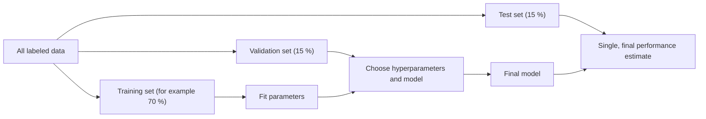

# Training, validation and test data

## Summary

A model is fitted on *training data*, tuned on *validation data* and judged once on *test data* that played no part in building it. Keeping these sets separate is what makes the reported performance an honest estimate of performance on new data. Reusing the same data for fitting and judging produces optimistic numbers that do not survive deployment.

## Prerequisites

- [Machine learning](../fundamentals/machine-learning.md) for the goal of generalization.
- [Features and labels](../fundamentals/features-and-labels.md) for what a dataset contains.

## Core concepts

### Definitions

- **Training data:** the dataset used to teach the model, that is, to fit its parameters.
- **Validation data:** a separate dataset used to choose hyperparameters, compare models and decide when to stop training.
- **Test data:** a separate dataset used to evaluate model performance at the end, once. It estimates how the final model will perform on new data.

The flowchart shows which decision each split feeds.

*Analogy.* Training data is the textbook, validation data is the practice exams a student uses to decide how to study, and test data is the final exam. If the student sees the final exam while studying, the grade no longer measures what they know. The analogy breaks in one way: a student cannot "accidentally" see an exam by computing a mean, but a preprocessing step fitted on the full dataset leaks test information into training in exactly that way.

### Split strategies

| Strategy | When to use it |
| --- | --- |
| Random split | Examples are independent and identically distributed (i.i.d.), and the dataset is large. |
| Stratified split | Classification with imbalanced classes: each split keeps the class proportions. |
| Time based split | Forecasting or any task where the model will predict the future: train on the past, validate and test on later periods. |
| Group split | Several examples belong to the same entity (patient, user, device): all examples of one entity go into the same split. |
| k-fold cross-validation | Small datasets: the training data is divided into k folds, each fold serves once as validation, and the k scores are averaged. |

### Cross-validation

In *k-fold cross-validation* the model is trained k times, each time on k-1 folds, and validated on the remaining fold. The mean of the k validation scores is a lower variance estimate than one split gives, and their spread shows how stable the model is. Typical values of k are 5 and 10. The test set stays outside the folds. *Nested cross-validation* adds an outer loop when both tuning and performance estimation must be done on a small dataset.

### Data leakage

*Leakage* is any path by which information from the validation or test data, or from the future, reaches the training process. Common paths:

- preprocessing (scaling, imputation, feature selection) fitted on the full dataset before splitting,
- duplicates or near duplicates of the same example in several splits,
- examples of the same patient or user in both training and test sets,
- random splits of time series, which let the model learn from the future.

## Worked example

A hospital builds a model that predicts readmission from 12,000 hospital stays of 4,000 patients, recorded from 2021 to 2025.

1. **Wrong:** a random 80/20 split of stays. The same patient appears in training and test data, and the model partly recognizes patients instead of learning risk factors. Test AUC looks high.
2. **Better:** a group split by patient, so that no patient is in two splits. The test score drops, and it is now honest about new patients.
3. **Right for deployment:** train on stays from 2021 to 2023, validate on 2024 and test on 2025, with patients grouped. This also measures how the model copes with changes in coding practice and treatment over time, which is how it will be used.

The pattern generalizes: the split must mimic how the model will meet data in production.

## Trade offs and when to use it

- Larger training sets fit better models, and larger test sets give more precise estimates. For datasets of millions of examples, a test set of 1 % may be plenty. For small datasets, cross-validation is the better use of data.
- Cross-validation multiplies training cost by k, which is often prohibitive for large neural networks. Those usually use a single fixed validation set.
- A test set that is reused for many decisions slowly becomes a validation set. Public benchmarks suffer from this at community scale.

## Common mistakes

- **Tuning on the test set.** Fix: tune on validation data, and look at the test set once at the end.
- **Fitting preprocessing before splitting.** Fix: split first, fit the scaler and imputer on training data, and apply them to the other splits.
- **Random splits for time series.** Fix: split by time.
- **Ignoring groups.** Fix: split by the entity that will be new in production (patient, customer, device).

## Practice

1. Why can a test score not be trusted after the test set was used to pick among 50 models?
2. Which split strategy fits a model that predicts next month's sales per store?
3. In 5-fold cross-validation on 1,000 examples, how many examples are used for training in each run?

Answers:

1. Picking the best of many models on the test set selects the one that happens to fit its noise, so the score is optimistically biased.
2. A time based split (train on earlier months, test on later months), possibly grouped by store when new stores matter.
3. 800 examples (four of the five folds).

## Further reading

- Hastie, T., Tibshirani, R. and Friedman, J. (2009). [*The Elements of Statistical Learning, 2nd edition*](https://hastie.su.domains/ElemStatLearn/). Springer. Section 7.10 covers cross-validation, including the wrong and the right way to do it.
- Kaufman, S., Rosset, S., Perlich, C. and Stitelman, O. (2012). [*Leakage in Data Mining: Formulation, Detection, and Avoidance*](https://doi.org/10.1145/2382577.2382579). ACM TKDD 6(4). A systematic treatment of data leakage.
- Kapoor, S. and Narayanan, A. (2023). [*Leakage and the reproducibility crisis in machine-learning-based science*](https://doi.org/10.1016/j.patter.2023.100804). Patterns 4(9). A survey of leakage errors across published studies.

TODO: check the content of this note against the sources above and record what was verified and when.
