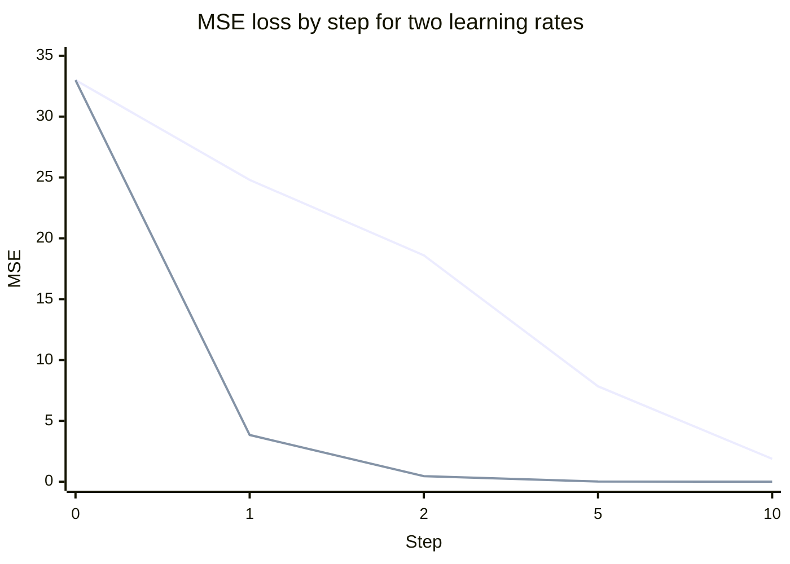

# Gradient descent

## Summary

Gradient descent is the iterative method that adjusts a model's parameters in the direction that reduces the loss. At each step it computes the gradient (the slope) of the loss with respect to every weight and moves each weight a small step against it, with the step size set by the *learning rate*. Almost every neural network, and many classical models, is trained with a variant of gradient descent.

## Prerequisites

- [Loss functions](loss-functions.md) for the quantity being minimized.
- Basic calculus: the derivative as the slope of a function. Partial derivatives and the gradient are defined below.

## Core concepts

### Definition

The weight update process is handled by gradient descent, which searches for the set of weights that minimizes the error. The *gradient* `∇J(θ)` is the vector of partial derivatives of the loss `J` with respect to each parameter. It points in the direction in which the loss grows fastest, so stepping against it decreases the loss.

How it works:

1. Compute the **gradient** (slope) of the loss function. The derivative of the loss tells the model whether to increase or decrease each weight.
2. **Update the weights** in the opposite direction of the gradient.
3. Repeat until the loss function reaches its minimum (optimal performance) or stops improving.

For a single weight the update is:

$$
w_{\text{new}} = w_{\text{old}} - \eta \times \text{Gradient}
$$

and in matrix form for all weights `W`:

$$
W_{\text{new}} = W_{\text{old}} - \eta \cdot \frac{\partial \text{Loss}}{\partial W}
$$

where:

- `η` (eta) is the **learning rate**, controlling how big the weight updates are,
- `∂Loss/∂W` is the derivative of the loss function with respect to the weights.

*Analogy.* A hiker in thick fog wants to reach the valley floor. They feel the slope under their feet (the gradient), take a step downhill (the update), and repeat. The learning rate is the length of the step. The analogy breaks in high dimensions: a neural network's landscape has millions of directions, and the hiker can end up on long flat plateaus or saddle points rather than in a simple valley.

### The learning rate

The learning rate is the most important hyperparameter of gradient descent:

- **Too small:** the model learns too slowly and takes too long to converge.
- **Too large:** the model overshoots the optimal point, oscillates, and fails to converge or diverges.
- **Well chosen:** the model reaches the lowest error efficiently.

For a quadratic loss the boundary is exact: gradient descent converges only if `η < 2 / λmax`, where `λmax` is the largest eigenvalue of the Hessian (the matrix of second derivatives). The worked example below lands on both sides of that boundary.

### Batch, stochastic and mini-batch gradient descent

The variants differ in how much data each gradient is computed from.

| Variant | Gradient computed on | Properties |
| --- | --- | --- |
| Batch gradient descent | The whole training set | Exact gradient, one update per epoch, too slow for large data. |
| Stochastic gradient descent (SGD) | One example | Very noisy, many cheap updates, noise can help escape poor regions. |
| Mini-batch gradient descent | A batch of, for example, 32 to 4,096 examples | The standard in deep learning: noise is controlled and the computation maps well onto GPUs. |

In deep learning "SGD" usually means the mini-batch variant.

### Improved optimizers

Plain gradient descent is slow in narrow valleys, where the gradient points across the valley rather than along it. Common refinements:

- **Momentum** keeps a running average of past gradients, which damps oscillation and speeds progress along consistent directions.
- **Adaptive methods** (AdaGrad, RMSProp, Adam) scale the step for each parameter by a running estimate of its gradient magnitude. Adam (Kingma and Ba, 2015) combines momentum with this scaling and is the default optimizer for most deep learning work, often in the AdamW form with decoupled weight decay.
- **Learning rate schedules** start with a short warm-up and then decay the rate, for example with a cosine curve.

### Convergence and local minima

For a convex loss, such as the MSE of linear regression, any minimum is the global minimum and gradient descent with a suitable learning rate reaches it. Neural network losses are not convex. In practice the main obstacles in high dimensions are saddle points and flat regions rather than bad local minima, and mini-batch noise helps to escape them. One full pass over the training data is an *epoch*, and training usually runs for many epochs until the loss stops improving (see [training a neural network](../../deep-learning/training/training-a-neural-network.md)).

## Worked example

Fit `y = w·x + b` to five points that lie exactly on `y = 2x + 1` by minimizing MSE with batch gradient descent, using three learning rates. Tested with Python 3.10 and NumPy 2.2.6.

```python
import numpy as np

# Five points that lie exactly on y = 2x + 1
x = np.array([0.0, 1.0, 2.0, 3.0, 4.0])
y = 2 * x + 1

def loss(w, b):
    return np.mean((w * x + b - y) ** 2)

def gradients(w, b):
    err = w * x + b - y
    return 2 * np.mean(err * x), 2 * np.mean(err)   # dL/dw, dL/db

for lr in (0.01, 0.1, 0.16):
    w, b = 0.0, 0.0
    history = []
    for step in range(51):
        if step in (0, 1, 2, 5, 10, 20, 50):
            history.append(f"{step}:{loss(w, b):.3g}")
        dw, db = gradients(w, b)
        w, b = w - lr * dw, b - lr * db      # the update rule
    print(f"lr={lr}: " + " ".join(history) + f"  -> w={w:.3f} b={b:.3f}")
```

Output (step:loss pairs, then the final parameters):

```text
lr=0.01: 0:33 1:24.8 2:18.6 5:7.84 10:1.88 20:0.123 50:0.013  -> w=2.067 b=0.804
lr=0.1: 0:33 1:3.84 2:0.461 5:0.0135 10:0.00691 20:0.00202 50:5.03e-05  -> w=2.004 b=0.988
lr=0.16: 0:33 1:43.2 2:56.6 5:127 10:490 20:7.29e+03 50:2.4e+07  -> w=2044.761 b=717.560
```

The chart plots the loss of the first ten steps for the two converging rates, from the output above.



Reading the result:

- **0.01 is too small:** after 50 steps the loss is still 0.013 and `b` is only 0.804 instead of 1.
- **0.1 converges fast:** the loss is below 0.001 after 50 steps and the parameters are close to `w = 2`, `b = 1`.
- **0.16 diverges:** the loss grows at every step. The largest eigenvalue of the Hessian of this loss is about 13.4, so the stability limit is `2 / 13.4 ≈ 0.149`, and 0.16 is just above it.

## Trade offs and when to use it

- Gradient descent needs a differentiable loss. Non-differentiable objectives (accuracy, ranking metrics) are optimized through differentiable surrogates such as cross-entropy.
- For small convex problems, closed form solutions (least squares) or second order methods (Newton, L-BFGS) converge in far fewer steps. Gradient descent wins when the model is large or the data does not fit in memory.
- Adam converges quickly with little tuning, while well tuned SGD with momentum sometimes generalizes better on vision tasks. This is an empirical observation that depends on the task.

## Common mistakes

- **Not scaling features.** Features on very different scales make the loss surface a narrow valley and force a tiny learning rate. Fix: standardize inputs.
- **Picking the learning rate once and forever.** Fix: run a short learning rate range test, and use a schedule with warm-up and decay.
- **Ignoring a rising loss.** A loss that grows or becomes `NaN` almost always means the learning rate is too high or the gradients explode. Fix: lower the rate, clip gradients and check the data for extreme values.
- **Confusing epochs, steps and batches.** Fix: one step is one update on one mini-batch, and one epoch is as many steps as it takes to see every training example once.

## Practice

1. In the update rule, why is the gradient subtracted rather than added?
2. With 50,000 training examples and a batch size of 100, how many steps make one epoch?
3. In the worked example, would a learning rate of 0.14 converge? Why?

Answers:

1. The gradient points in the direction of steepest increase of the loss, so moving against it decreases the loss.
2. 500 steps.
3. Yes, because 0.14 is below the stability limit of about 0.149, although it would oscillate before settling.

## Further reading

- Goodfellow, I., Bengio, Y. and Courville, A. (2016). [*Deep Learning*](https://www.deeplearningbook.org/). MIT Press. Chapters 4 and 8 cover gradient based optimization and its variants for deep networks.
- Ruder, S. (2016). [*An overview of gradient descent optimization algorithms*](https://arxiv.org/abs/1609.04747). arXiv. A compact survey of momentum, AdaGrad, RMSProp and Adam.
- Kingma, D. and Ba, J. (2015). [*Adam: A Method for Stochastic Optimization*](https://arxiv.org/abs/1412.6980). ICLR 2015. The Adam optimizer.
- Boyd, S. and Vandenberghe, L. (2004). [*Convex Optimization*](https://web.stanford.edu/~boyd/cvxbook/). Cambridge University Press. Chapter 9 proves convergence of descent methods on convex problems.

TODO: check the content of this note against the sources above and record what was verified and when.
