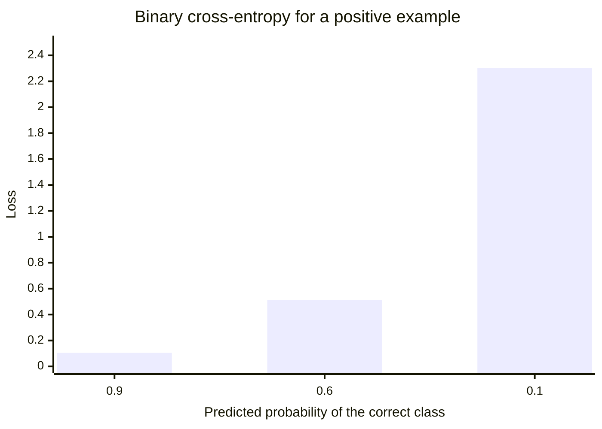

# Loss functions

## Summary

A loss function (also called a cost function or objective) measures how far a model's prediction `ŷ` is from the actual value `y`. Training means finding the parameters that make the average loss over the training data as small as possible. Mean squared error is the standard loss for regression and cross-entropy the standard loss for classification, and the choice of loss decides what the model treats as a serious mistake.

## Prerequisites

- [Features and labels](../fundamentals/features-and-labels.md) for `y`, the label the prediction is compared with.
- [AI model](../../ai-foundations/what-is-ai/ai-model.md) for parameters and predictions.

## Core concepts

### Definition

After the model produces a predicted output `ŷ` (read "y-hat"), we need to measure how well it performed. A *loss function* calculates the difference between the actual and the predicted values:

$$
\text{Loss} = \text{Error}(Y, \hat{Y})
$$

The loss of one example is usually written `L(y, ŷ)`, and the *cost* or *objective* `J(θ)` is its average over the n training examples, often plus a regularization term:

$$
J(\theta) = \frac{1}{n} \sum_{i=1}^{n} L\big(y_i, f(x_i; \theta)\big) + \lambda R(\theta)
$$

The goal of training is to minimize the loss, so that the predicted values are as close as possible to the actual values. [Gradient descent](gradient-descent.md) does the minimizing, and [backpropagation](../../deep-learning/training/backpropagation.md) computes the gradients it needs in neural networks.

### Mean squared error

Mean squared error (MSE) is used for regression problems:

$$
\text{MSE} = \frac{1}{n} \sum_{i=1}^{n} (y_i - \hat{y}_i)^2
$$

Squaring makes all errors positive and punishes large errors much more than small ones: an error of 10 costs 100 times as much as an error of 1. That makes MSE sensitive to outliers. Minimizing MSE is equivalent to maximum likelihood estimation when the noise on `y` is Gaussian, which is the statistical reason for its popularity. The *mean absolute error* (MAE) and the *Huber loss* are more robust alternatives when outliers are expected.

### Cross-entropy

Cross-entropy loss is used for classification problems. It measures the difference between two probability distributions: the true distribution (all probability on the correct class) and the distribution the model predicts.

For binary classification with predicted probability `p` of the positive class (*binary cross-entropy*, also called log loss):

$$
L(y, p) = -\big[\, y \log p + (1 - y) \log (1 - p) \,\big]
$$

For K classes with a one-hot label `y` and predicted probabilities `p` (usually the output of a softmax):

$$
L(y, p) = -\sum_{k=1}^{K} y_k \log p_k
$$

Only the probability assigned to the correct class matters, and the loss grows without bound as that probability approaches zero. A confident wrong answer is punished far more than an unsure one. Minimizing cross-entropy is equivalent to maximizing the likelihood of the labels under the model.

### Choosing a loss

The table maps common tasks to their standard loss.

| Task | Output layer | Loss |
| --- | --- | --- |
| Regression | Linear | MSE (or MAE, Huber for outliers) |
| Binary classification | Sigmoid | Binary cross-entropy |
| Multi-class classification (one label) | Softmax | Categorical cross-entropy |
| Multi-label classification | Sigmoid per label | Binary cross-entropy per label |
| Language modeling | Softmax over the vocabulary | Cross-entropy of the next token |

The loss used for training is not always the metric used for reporting. A fraud model is trained with cross-entropy (smooth and differentiable) but judged by recall at a fixed precision (see [classification metrics](../model-evaluation/classification-metrics.md)), because accuracy and recall are not differentiable.

## Worked example

Tested with Python 3.10 and NumPy 2.2.6.

```python
import numpy as np

def mse(y, y_hat):
    return np.mean((y - y_hat) ** 2)

def binary_cross_entropy(y, p, eps=1e-12):
    p = np.clip(p, eps, 1 - eps)   # avoid log(0)
    return -np.mean(y * np.log(p) + (1 - y) * np.log(1 - p))

def categorical_cross_entropy(one_hot, probs):
    return -np.sum(one_hot * np.log(probs))

print("MSE:", mse(np.array([3.0, 5.0]), np.array([2.5, 6.0])))
for p in (0.9, 0.6, 0.1):
    print(f"BCE for a positive example predicted p={p}: {binary_cross_entropy(np.array([1.0]), np.array([p])):.3f}")
probs = np.array([0.7, 0.2, 0.1])
print("CE, true class 0:", round(categorical_cross_entropy(np.array([1, 0, 0]), probs), 3))
print("CE, true class 2:", round(categorical_cross_entropy(np.array([0, 0, 1]), probs), 3))
```

Output:

```text
MSE: 0.625
BCE for a positive example predicted p=0.9: 0.105
BCE for a positive example predicted p=0.6: 0.511
BCE for a positive example predicted p=0.1: 2.303
CE, true class 0: 0.357
CE, true class 2: 2.303
```

The chart shows the binary cross-entropy of a positive example from the output above. Lowering the predicted probability from 0.9 to 0.6 costs about 0.4, but lowering it further to 0.1 costs about 1.8 more.



## Trade offs and when to use it

- MSE is smooth and simple, but outliers dominate it. Use MAE or Huber when a few large errors should not drive the fit.
- Cross-entropy gives strong gradients for confident mistakes, which makes training fast, but it also pushes models toward overconfidence. Label smoothing and temperature scaling are used to calibrate probabilities.
- Class imbalance can be handled inside the loss with class weights or the *focal loss*, which down-weights easy examples.
- A custom loss can encode business costs directly (a missed fraud costs more than a false alarm), but it must stay differentiable for gradient based training.

## Common mistakes

- **Using MSE for classification.** Combined with a sigmoid output, MSE gives tiny gradients for confident wrong predictions and trains slowly. Fix: use cross-entropy.
- **Taking `log(0)`.** A predicted probability of exactly 0 for the true class gives an infinite loss. Fix: clip probabilities or, better, compute the loss from logits with a numerically stable function (log-softmax).
- **Applying softmax twice.** Many libraries expect raw logits in their cross-entropy function and apply softmax internally. Fix: read the documentation of the loss and pass logits when it asks for them.
- **Comparing losses across datasets.** A loss value has no absolute meaning. Fix: compare losses of models on the same data, and report task metrics to people.

## Practice

1. Why does MSE punish one error of 10 more than ten errors of 1?
2. What is the cross-entropy loss when the model assigns probability 1.0 to the correct class?
3. Which loss fits a model that tags a photo with any number of labels from "beach", "dog" and "sunset"?

Answers:

1. One error of 10 contributes 100, ten errors of 1 contribute 10 in total.
2. Zero, because log(1) = 0.
3. Binary cross-entropy for each label with a sigmoid output per label (multi-label classification).

## Further reading

- Goodfellow, I., Bengio, Y. and Courville, A. (2016). [*Deep Learning*](https://www.deeplearningbook.org/). MIT Press. Section 6.2 derives the common losses from maximum likelihood.
- Murphy, K. (2022). [*Probabilistic Machine Learning: An Introduction*](https://probml.github.io/pml-book/book1.html). MIT Press. Chapters 4 and 5 connect losses, likelihood and decision theory.
- Lin, T.-Y. et al. (2017). [*Focal Loss for Dense Object Detection*](https://arxiv.org/abs/1708.02002). ICCV 2017. The focal loss for heavily imbalanced classes.

TODO: check the content of this note against the sources above and record what was verified and when.
