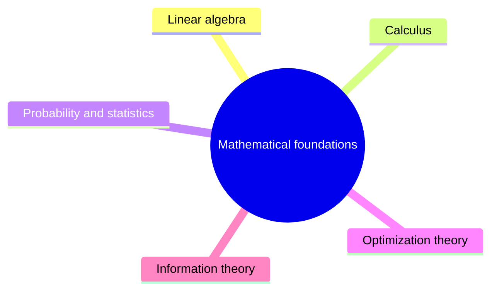

# Mathematical foundations

The mathematics that machine learning rests on: linear algebra, calculus, probability and statistics, optimization theory and information theory.

This knowledge area is a supporting area. It follows the mathematical requirements that [Computer Science Curricula 2023](https://csed.acm.org/) (ACM, IEEE-CS and AAAI) states for the AI knowledge area and its Mathematical and Statistical Foundations knowledge area.

## Map

The map shows the sections of this knowledge area.

## Sections

- [Linear algebra](linear-algebra/README.md) (planned): Vectors, matrices and the decompositions used throughout machine learning.
- [Calculus](calculus/README.md) (planned): Derivatives and gradients, the basis of training by gradient descent.
- [Probability and statistics](probability-and-statistics/README.md) (planned): Distributions, estimation and inference.
- [Optimization theory](optimization-theory/README.md) (planned): Convexity and constrained optimization.
- [Information theory](information-theory/README.md) (planned): Entropy and the information measures behind common loss functions.

TODO: no notes yet in this knowledge area. Start with the first planned topic of the first section.
