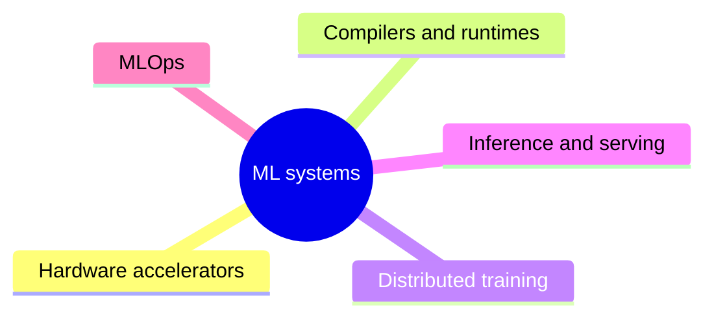

# ML systems

The systems that train and run models: hardware accelerators, compilers and runtimes, distributed training, inference and serving, and MLOps.

This knowledge area is a supporting area outside the AI knowledge area of [Computer Science Curricula 2023](https://csed.acm.org/) (ACM, IEEE-CS and AAAI). It draws on the Architecture and Organization and the Parallel and Distributed Computing knowledge areas, applied to machine learning workloads.

## Map

The map shows the sections of this knowledge area.

## Sections

- [Hardware accelerators](hardware-accelerators/README.md) (2 notes): GPUs, TPUs and the programming models that drive them.
- [Compilers and runtimes](compilers-and-runtimes/README.md) (1 note): Software that turns model code into efficient kernels.
- [Distributed training](distributed-training/README.md) (planned): Training models across many accelerators.
- [Inference and serving](inference-and-serving/README.md) (planned): Running trained models efficiently in production.
- [MLOps](mlops/README.md) (planned): Engineering practices for the life cycle of machine learning models.
