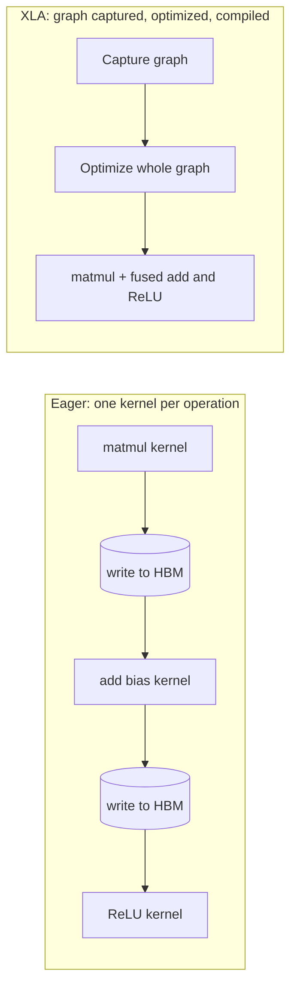

# Accelerated Linear Algebra (XLA)

## Summary

Accelerated Linear Algebra (XLA) is a domain-specific compiler for machine learning, originally developed by Google and now maintained in the OpenXLA project. Instead of running each operation as soon as it is called (eager execution), XLA captures a whole computation graph, such as a network layer or a full training step, optimizes the entire graph and compiles it into efficient machine code for the target accelerator. Its key optimizations are operator fusion, memory optimization and layout optimization. It is the compiler behind JAX and TPUs, and it is also used for GPUs and CPUs.

## Prerequisites

- [CUDA](../hardware-accelerators/cuda.md) for kernels and why memory traffic limits speed.
- [Training a neural network](../../deep-learning/training/training-a-neural-network.md) for what a training step computes.

## Core concepts

### Definition

XLA is a compiler whose input is a graph of tensor operations (in StableHLO or its predecessor HLO, High Level Operations) and whose output is optimized code for a specific device. Although it was initially focused on Google's TPUs, its principles apply to other accelerators, including GPUs. It works like a just-in-time (JIT) compiler specialized for linear algebra: when a function is first called with given tensor shapes, XLA traces it into a graph, compiles it, caches the result and reuses it for later calls with the same shapes.

### Eager execution and graph compilation

The diagram contrasts the two execution models for three operations: a matrix multiplication, a bias addition and a ReLU.



In eager execution (the default in PyTorch), each operation launches its own kernel and writes its full result to GPU memory, and the next kernel reads it back. XLA sees all three operations at once and can avoid the intermediate writes.

### Key optimizations

- **Operator fusion:** combining several small operations into a single, larger kernel (a CUDA kernel on GPUs). This sharply reduces kernel launch overhead and intermediate memory transfers, which matters because elementwise operations are memory bound.
- **Memory optimization:** analyzing the graph to minimize allocations and deallocations, reuse buffers whose values are no longer needed and schedule operations to lower peak memory.
- **Layout optimization:** arranging data in memory (for example the order of the batch, height, width and channel dimensions) to match the hardware's access patterns.
- Further passes include constant folding, algebraic simplification, and partitioning of the graph across many devices (GSPMD), which XLA uses to scale a single program over thousands of TPU chips.

### Where XLA is used

- **JAX:** every `jax.jit` function is compiled by XLA.
- **TensorFlow:** optional, through `jit_compile=True`.
- **PyTorch:** on TPUs through PyTorch/XLA. On GPUs, PyTorch's own compiler (`torch.compile` with TorchInductor and Triton) fills the same role with a different design.
- **TPUs:** XLA is the compiler that targets them (see [TPU](../hardware-accelerators/tpu.md)).

## Worked example

A dense layer with ReLU, `y = relu(x @ W + b)`, in JAX. Untested here (JAX was not installed in the environment where this note was written). It follows the JAX documentation for `jax.jit`.

```python
# Python 3.10+, JAX (any recent version)
import jax
import jax.numpy as jnp

def dense_relu(x, W, b):
    return jax.nn.relu(x @ W + b)

fast_dense_relu = jax.jit(dense_relu)        # compiled by XLA on first call

x = jnp.ones((1024, 512)); W = jnp.ones((512, 256)); b = jnp.zeros((256,))
y = fast_dense_relu(x, W, b)                 # first call: trace + compile + run
y = fast_dense_relu(x, W, b)                 # later calls with the same shapes: run only
print(y.shape)                               # (1024, 256)

# Inspect the optimized program that XLA produced
print(jax.jit(dense_relu).lower(x, W, b).compile().as_text()[:400])
```

Why fusion helps here, with arithmetic on the shapes above (32-bit floats):

- The output has 1024 × 256 = 262,144 values, 1 MB.
- Eager execution writes the matmul result (1 MB), reads it to add the bias, writes the sum (1 MB), reads it for ReLU and writes the final result (1 MB): about 5 MB of traffic for the elementwise steps.
- With bias and ReLU fused into the matmul's output stage, the result is written once: about 1 MB. The elementwise steps become almost free.

## Trade offs and when to use it

- **Benefits:** faster execution and lower memory through whole-graph optimization, and one program that can be compiled for TPUs, GPUs and CPUs.
- **Compilation cost:** the first call compiles, which can take seconds to minutes for large models. New input shapes trigger recompilation, so variable shapes (for example variable sequence lengths) need padding or bucketing.
- **Restrictions:** compiled functions must be traceable: Python control flow that depends on tensor values must use special constructs (`jax.lax.cond`, `jax.lax.scan`), and side effects such as printing behave differently.
- **Debugging** compiled graphs is harder than stepping through eager code.

## Common mistakes

- **Recompiling every step** because shapes change. Fix: pad inputs to a few fixed sizes.
- **Timing the first call.** It includes compilation. Fix: warm up, then measure, and synchronize before stopping the timer (`block_until_ready()` in JAX).
- **Value-dependent Python control flow inside a jitted function.** Fix: use the framework's structured control flow operations.

## Practice

1. Why does fusing a bias addition and a ReLU into the preceding matrix multiplication speed up execution?
2. What happens when a jitted function is called with a new input shape?
3. Name two frameworks that use XLA.

Answers:

1. The elementwise operations are memory bound. Fusion avoids writing and rereading intermediate results and saves kernel launches.
2. XLA traces and compiles a new version for that shape, which costs compilation time.
3. JAX and TensorFlow (also PyTorch on TPUs through PyTorch/XLA).

## Further reading

- OpenXLA (2025). [*XLA documentation*](https://openxla.org/xla). Architecture, HLO and the optimization passes.
- JAX (2025). [*Just-in-time compilation*](https://docs.jax.dev/en/latest/jit-compilation.html). How `jax.jit` traces and compiles functions with XLA.
- Xu, Y. et al. (2021). [*GSPMD: General and Scalable Parallelization for ML Computation Graphs*](https://arxiv.org/abs/2105.04663). arXiv. How XLA partitions one program across many devices.

TODO: check the content of this note against the sources above and record what was verified and when.
