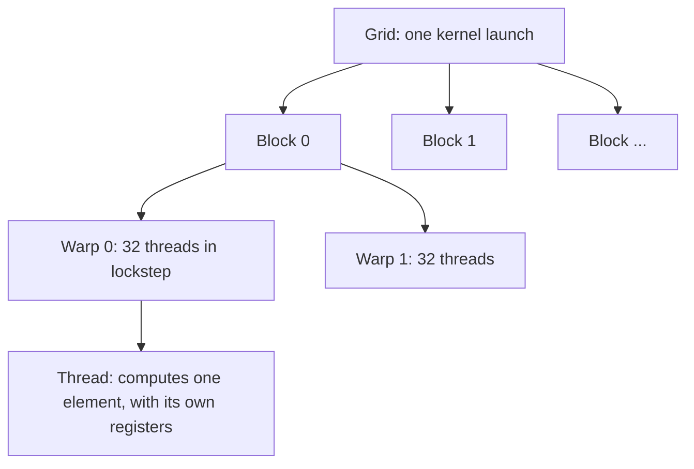

# CUDA

## Summary

CUDA (Compute Unified Device Architecture) is NVIDIA's parallel computing platform and programming model for its GPUs. Deep learning frameworks do not run operations such as a matrix multiplication (`torch.matmul`) or a convolution as generic CPU instructions: they dispatch highly optimized, precompiled CUDA kernels to the GPU, which run the same operation on thousands of data elements at once. Understanding CUDA's model of threads, blocks and memory explains why GPUs are fast for neural networks and what limits their speed.

## Prerequisites

- [Training a neural network](../../deep-learning/training/training-a-neural-network.md), whose matrix products are what GPUs accelerate.

## Core concepts

### Definition

CUDA, introduced by NVIDIA in 2006 and 2007, consists of a programming model (kernels, threads, blocks, grids), language extensions for C++ (CUDA C++), a compiler (`nvcc`), a runtime and driver API, and libraries such as cuBLAS (linear algebra) and cuDNN (deep learning primitives). It is the main programming interface for NVIDIA GPUs. Strictly, it is not the lowest level: CUDA C++ compiles to PTX, a virtual instruction set, which the driver translates to SASS, the native machine code of each GPU generation.

*Analogy.* A CPU is a small team of expert chefs who each cook complex dishes quickly. A GPU is a huge kitchen of line cooks who all perform the same simple step at the same time, such as chopping one onion each. For a banquet of identical salads the line cooks win by far. For one complicated dish with many dependent steps, the experts win. The analogy breaks on memory: in a GPU, getting ingredients (data) to the cooks is often the real bottleneck, not the cooking.

### CPUs and GPUs

A CPU core handles one or two hardware threads at a time and is optimized for low latency on sequential code, with large caches and branch prediction. A GPU is designed for throughput: thousands of simple cores run the same instruction on different data. As an example, the NVIDIA H100 (SXM5 version, 2022) has 132 streaming multiprocessors with 16,896 FP32 CUDA cores in total, plus Tensor Cores for matrix operations. CUDA programs use both processors together: the CPU (the *host*) runs the control logic and launches kernels, and the GPU (the *device*) runs the parallel work.

### The programming model

A *kernel* is a function that runs on the GPU, executed by many threads in parallel. Threads are organized in a hierarchy, shown in the diagram.



- A **thread** executes the kernel for its own index.
- A **block** groups up to 1,024 threads that run on one streaming multiprocessor and can share fast *shared memory* and synchronize.
- A **grid** is all the blocks of one launch.
- A **warp** is a group of 32 threads that the hardware executes in lockstep. If threads of a warp take different branches, the branches run one after another (*warp divergence*).

The figure shows the classic example, vector addition: element `i` of C is computed by thread `i` as `C[i] = A[i] + B[i]`, and all rows run in parallel. The launch syntax `VecAdd<<<1, n>>>` starts one block of `n` threads. Simplified figures often abbreviate it as `VecAdd<<n>>`.

![Three columns A, B and C of n elements each; thread i computes C[i] = A[i] + B[i], and the kernel VecAdd is launched with n threads](../../_assets/ml-systems/cuda-vector-addition.svg)

### How CUDA powers GPU performance

- **Tensor Cores and the memory hierarchy.** CUDA kernels are engineered to use the GPU's Tensor Cores (units that compute small matrix products per instruction) and its memory hierarchy: registers (per thread, fastest), shared memory (per block), L2 cache, and high bandwidth memory (HBM, the GPU's main memory, largest and slowest).
- **Coalesced memory access.** When the 32 threads of a warp read 32 consecutive addresses, the hardware combines them into a few wide memory transactions. Accessing memory in the way the hardware expects gives maximum bandwidth, and scattered access can be many times slower.
- **Efficient parallel execution.** Enough threads must be in flight to hide memory latency: while some warps wait for data, others compute.

Together these give much higher speed than CPU execution for parallelizable work such as matrix multiplication, which is why deep learning moved to GPUs after AlexNet (2012) was trained on two of them.

### Compute bound and memory bound

A kernel is *compute bound* if its speed is limited by arithmetic and *memory bound* if it is limited by moving data. Large matrix multiplications are compute bound. Elementwise operations (adding a bias, applying ReLU) are memory bound: they do one operation per value loaded. The *roofline model* compares a kernel's arithmetic intensity (operations per byte) with the hardware's ratio of compute to bandwidth. Most of a network's operations are memory bound, which is why fusing them into fewer kernels, as [XLA](../compilers-and-runtimes/xla.md) does, speeds up training.

## Worked example

Vector addition in CUDA C++, with the indexing used in real code for vectors larger than one block. Untested here (no GPU or `nvcc` in the environment where this note was written). It follows the CUDA C++ Programming Guide.

```cpp
// CUDA C++; compile with: nvcc vec_add.cu -o vec_add
#include <cstdio>
#include <cuda_runtime.h>

__global__ void vecAdd(const float* A, const float* B, float* C, int n) {
    int i = blockIdx.x * blockDim.x + threadIdx.x;   // global index of this thread
    if (i < n) {                                     // the last block may be partly unused
        C[i] = A[i] + B[i];                          // consecutive threads read consecutive addresses: coalesced
    }
}

int main() {
    const int n = 1 << 20;                           // 1,048,576 elements
    size_t bytes = n * sizeof(float);
    float *A, *B, *C;
    cudaMallocManaged(&A, bytes);                    // unified memory, visible to host and device
    cudaMallocManaged(&B, bytes);
    cudaMallocManaged(&C, bytes);
    for (int i = 0; i < n; ++i) { A[i] = 1.0f; B[i] = 2.0f; }

    int threads = 256;
    int blocks = (n + threads - 1) / threads;        // 4,096 blocks
    vecAdd<<<blocks, threads>>>(A, B, C, n);
    cudaDeviceSynchronize();                         // wait for the GPU before reading C

    printf("C[0] = %.1f, C[n-1] = %.1f\n", C[0], C[n - 1]);
    cudaFree(A); cudaFree(B); cudaFree(C);
    return 0;
}
```

Expected output: `C[0] = 3.0, C[n-1] = 3.0`. Arithmetic check: 1,048,576 elements need 4,096 blocks of 256 threads. Each thread loads 8 bytes and stores 4, so the kernel moves about 12.6 MB and does about one million additions: it is memory bound, and its speed is set by memory bandwidth, not by the number of cores.

## Trade offs and when to use it

- Writing custom CUDA kernels is rarely needed: frameworks call cuBLAS, cuDNN and generated kernels. Custom kernels pay off for operations the libraries do not cover well, such as new attention variants (FlashAttention began as custom CUDA).
- Higher level tools such as OpenAI Triton (Python-like kernels) and compilers such as XLA and `torch.compile` produce good kernels with far less effort.
- CUDA is specific to NVIDIA. AMD's ROCm (HIP), Google's TPUs (programmed through XLA) and other accelerators use different stacks, which matters for portability and vendor lock-in.

## Common mistakes

- **Uncoalesced memory access** (strided or scattered). Fix: lay out data so that consecutive threads access consecutive addresses.
- **Forgetting the bounds check** `if (i < n)`. The last block writes past the end of the array. Fix: always guard the index.
- **Reading results before synchronization.** Kernel launches are asynchronous. Fix: synchronize, or use operations that synchronize implicitly.
- **Measuring time without synchronization.** CPU timers stop before the GPU finishes. Fix: use CUDA events or synchronize before stopping the timer.
- **Small, many kernels.** Each launch has an overhead of microseconds. Fix: fuse operations or batch work.

## Practice

1. How many blocks of 128 threads are needed for 1,000 elements, and how many threads do nothing?
2. Why is adding two vectors memory bound?
3. What is a warp, and why does branching inside a warp cost time?

Answers:

1. 8 blocks (1,024 threads), so 24 threads fail the bounds check and do nothing.
2. It performs one addition per 12 bytes moved, far below the arithmetic intensity at which the GPU's compute units become the limit.
3. A group of 32 threads executed in lockstep. When threads take different branches, the warp runs each branch in turn with some threads idle.

## Further reading

- NVIDIA (2025). [*CUDA C++ Programming Guide*](https://docs.nvidia.com/cuda/cuda-c-programming-guide/). The reference for the programming model, memory hierarchy and kernel launch syntax.
- Hwu, W., Kirk, D. and El Hajj, I. (2022). *Programming Massively Parallel Processors, 4th edition*. Morgan Kaufmann. The standard textbook on GPU programming.
- NVIDIA (2022). [*NVIDIA H100 Tensor Core GPU Architecture*](https://resources.nvidia.com/en-us-tensor-core). Whitepaper with the streaming multiprocessor and core counts used above.
- Williams, S., Waterman, A. and Patterson, D. (2009). [*Roofline: An Insightful Visual Performance Model for Multicore Architectures*](https://doi.org/10.1145/1498765.1498785). Communications of the ACM 52(4). The roofline model.

TODO: check the content of this note against the sources above and record what was verified and when.
