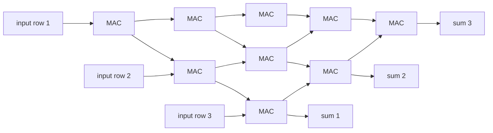

# Tensor Processing Unit (TPU)

## Summary

A Tensor Processing Unit (TPU) is an application-specific integrated circuit (ASIC) that Google designed to accelerate neural network computations. Its core is a large *systolic array* of multiply-accumulate units that computes matrix multiplications while passing data directly between neighboring units, which saves most of the memory traffic a general purpose processor would need. TPUs are programmed through the XLA compiler (from JAX, TensorFlow or PyTorch/XLA), are available only in Google's data centers and Google Cloud, and are connected into *pods* of thousands of chips for training large models.

## Prerequisites

- [CUDA](cuda.md) for how GPUs accelerate the same workloads.
- [Accelerated Linear Algebra (XLA)](../compilers-and-runtimes/xla.md), the compiler that targets TPUs.

## Core concepts

### Definition

A TPU is a domain-specific accelerator: it gives up the generality of CPUs and, to a lesser degree, GPUs in exchange for efficiency on dense matrix operations, which dominate neural network training and inference. Google deployed the first TPU (v1, inference only, 8-bit integer arithmetic) in its data centers in 2015 and described it publicly in 2017. Later generations added training support with floating point formats such as bfloat16, high bandwidth memory and dedicated chip-to-chip interconnects.

*Analogy.* A GPU is a large workshop with many general purpose workbenches. A TPU is an assembly line built for one product: parts move from station to station without going back to the warehouse between steps. The assembly line is far more efficient for that product and useless for others. The analogy holds for the systolic array. It breaks because TPUs also contain vector and scalar units, so they handle the other operations of a network, only less efficiently than matrix products.

### The systolic array

The matrix unit (MXU) is a grid of multiply-accumulate (MAC) cells, 256 × 256 in TPU v1 and 128 × 128 per MXU in several later generations. Weights are loaded into the cells, input values flow through the grid in one direction and partial sums in the other, and each cell multiplies, adds and passes its result to the neighbor in each clock cycle. The name comes from the rhythmic pumping of data, like a heartbeat (systole). The diagram shows a 3 × 3 array with inputs entering from the left and sums leaving at the bottom.

Each value read from memory is reused by many cells before the result is written back, so the array performs many operations per byte of memory traffic. That is exactly what a memory bound processor lacks (see the roofline discussion in [CUDA](cuda.md#compute-bound-and-memory-bound)).

### System design

- **Precision:** TPUs popularized *bfloat16*, a 16-bit format with the same exponent range as 32-bit floats and fewer mantissa bits, which suits neural network training without loss scaling.
- **Memory:** high bandwidth memory (HBM) next to each chip in training generations.
- **Interconnect:** chips are linked in 2D or 3D torus topologies by dedicated inter-chip interconnect. TPU v4 added optically reconfigurable switching for pods of 4,096 chips (Jouppi et al., 2023).
- **Software:** TPUs run XLA-compiled programs only. There is no equivalent of writing arbitrary CUDA kernels, although Pallas (in JAX) allows custom kernels.

### TPUs and GPUs

| Aspect | TPU | GPU |
| --- | --- | --- |
| Design | ASIC for dense tensor operations | General purpose parallel processor with tensor units |
| Programming | Through XLA (JAX, TensorFlow, PyTorch/XLA) | CUDA, libraries, many compilers and frameworks |
| Availability | Google Cloud and Google internally | Every major cloud and on premises |
| Strength | Efficiency and scale for large, regular workloads | Flexibility, ecosystem, custom kernels |
| Weakness | Less flexible for irregular operations and dynamic shapes | Power and cost per operation for pure matrix workloads |

## Worked example

Why the systolic array is efficient, with arithmetic on a 256 × 256 array (the TPU v1 size):

- The array has 256 × 256 = 65,536 MAC units, each performing one multiply and one add per cycle.
- At the 700 MHz clock reported for TPU v1, that is 65,536 × 2 × 700 × 10^6 ≈ 92 × 10^12 operations per second, the 92 TOPS (8-bit) figure of Jouppi et al. (2017).
- To multiply a batch of input vectors by a 256 × 256 weight tile, the weights are loaded once and stay in the cells, and each input value read from memory is used by 256 cells as it flows across. A design that fetched both operands from memory for every multiplication would need hundreds of times more memory bandwidth for the same work.

The same paper reported that TPU v1 was on average 15 to 30 times faster and 30 to 80 times more efficient in performance per watt than contemporary CPUs and GPUs on Google's inference workloads. These are 2017 measurements of 2015 hardware, and they do not describe current generations.

## Trade offs and when to use it

- Choose TPUs for large training and inference jobs on Google Cloud, especially with JAX, where pods give access to very large scale with a uniform interconnect.
- Choose GPUs when the workload needs custom kernels, dynamic shapes, frameworks without good XLA support, or deployment outside Google Cloud.
- Cost comparisons depend on the generation, the model and the pricing at the time. Measure the cost per training step or per token on your workload instead of comparing peak FLOPS.

## Common mistakes

- **Comparing peak FLOPS.** Real utilization depends on the model, batch size and compiler. Fix: benchmark the actual workload.
- **Dynamic shapes on TPUs.** Every new shape recompiles. Fix: pad to fixed sizes.
- **Input pipeline bottlenecks.** A TPU pod can process data faster than a naive input pipeline delivers it. Fix: prefetch and parallelize data loading, and monitor accelerator idle time.

## Practice

1. Why does a systolic array need less memory bandwidth than a design that fetches every operand from memory?
2. What advantage does bfloat16 have over the IEEE 16-bit float format for training?
3. Through which compiler must every TPU program pass?

Answers:

1. Weights stay in the cells and each input value is reused by many cells as it flows through the array, so many operations are performed per byte read.
2. It keeps the 8-bit exponent of 32-bit floats, so it covers the same range of magnitudes and avoids overflow and underflow without loss scaling.
3. XLA.

## Further reading

- Jouppi, N. et al. (2017). [*In-Datacenter Performance Analysis of a Tensor Processing Unit*](https://arxiv.org/abs/1704.04760). ISCA 2017. The TPU v1 paper with the architecture and the performance figures used above.
- Jouppi, N. et al. (2023). [*TPU v4: An Optically Reconfigurable Supercomputer for Machine Learning with Hardware Support for Embeddings*](https://arxiv.org/abs/2304.01433). ISCA 2023. Pod scale design and interconnect.
- Google Cloud (2025). [*Introduction to Cloud TPU*](https://cloud.google.com/tpu/docs/intro-to-tpu). Current TPU generations, programming model and system architecture.
- Kung, H. T. (1982). [*Why Systolic Architectures?*](https://doi.org/10.1109/MC.1982.1653825). IEEE Computer 15(1). The original argument for systolic arrays.

TODO: check the content of this note against the sources above and record what was verified and when.
