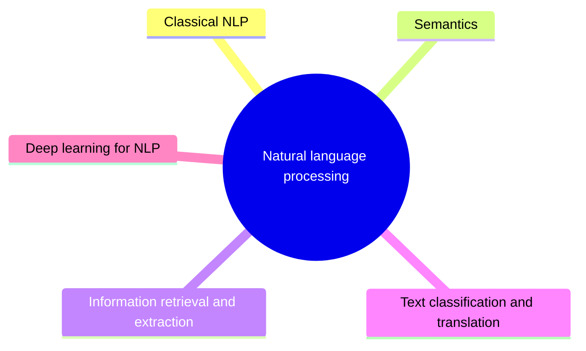

# Natural language processing

Computational processing of human language: grammars and parsing, statistical language models, semantics, information retrieval and extraction, classification, translation and deep learning for language.

This knowledge area follows the knowledge unit AI-NLP (Natural Language Processing) of the AI knowledge area in [Computer Science Curricula 2023](https://csed.acm.org/) (ACM, IEEE-CS and AAAI). Large language models are in [generative AI](../generative-ai/README.md).

## Map

The map shows the sections of this knowledge area.

## Sections

- [Classical NLP](classical-nlp/README.md) (planned): Grammars, parsing and statistical models of language.
- [Semantics](semantics/README.md) (planned): Representing the meaning of language.
- [Information retrieval and extraction](information-retrieval-and-extraction/README.md) (planned): Finding relevant documents and extracting structured facts from text.
- [Text classification and translation](text-classification-and-translation/README.md) (planned): Assigning categories to text and translating between languages.
- [Deep learning for NLP](deep-learning-for-nlp/README.md) (planned): Neural models of language, from word embeddings to transformers.

TODO: no notes yet in this knowledge area. Start with the first planned topic of the first section.
