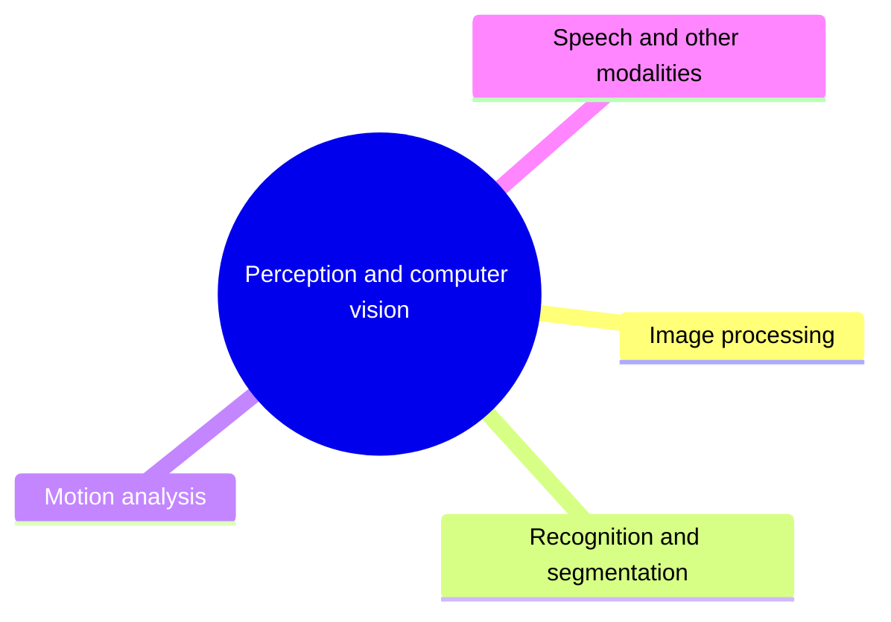

# Perception and computer vision

Interpreting sensory data: image processing, recognition and segmentation, motion analysis, and speech and other modalities.

This knowledge area follows the knowledge unit AI-Vision (Perception and Computer Vision) of the AI knowledge area in [Computer Science Curricula 2023](https://csed.acm.org/) (ACM, IEEE-CS and AAAI).

## Map

The map shows the sections of this knowledge area.

## Sections

- [Image processing](image-processing/README.md) (planned): Image acquisition, representation and low-level processing.
- [Recognition and segmentation](recognition-and-segmentation/README.md) (planned): Recognizing objects and delineating them in images.
- [Motion analysis](motion-analysis/README.md) (planned): Understanding motion in image sequences and video.
- [Speech and other modalities](speech-and-other-modalities/README.md) (planned): Perception beyond vision: audio, speech, touch and other senses.

TODO: no notes yet in this knowledge area. Start with the first planned topic of the first section.
