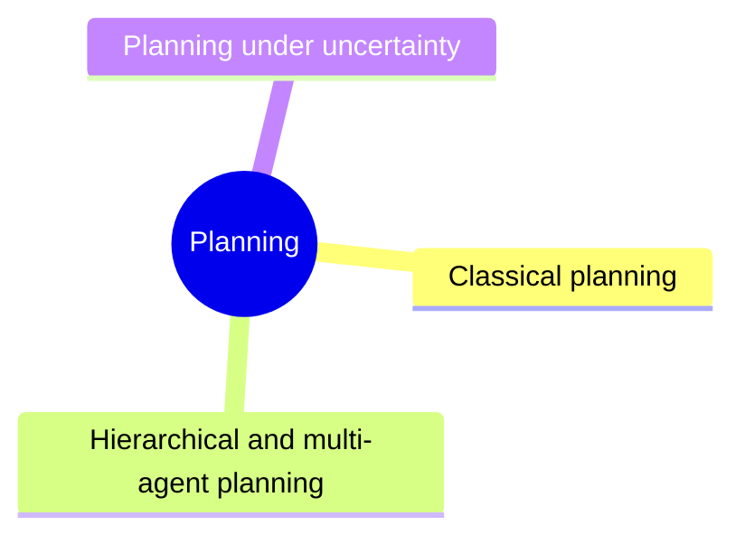

# Planning

Finding sequences of actions that achieve goals: classical, hierarchical and multi-agent planning, and planning under uncertainty.

This knowledge area follows the knowledge unit AI-Planning of the AI knowledge area in [Computer Science Curricula 2023](https://csed.acm.org/) (ACM, IEEE-CS and AAAI). Planning strategies of LLM agents are in [agents and cognitive systems](../agents-and-cognitive-systems/llm-agents/planning-strategies.md).

## Map

The map shows the sections of this knowledge area.

## Sections

- [Classical planning](classical-planning/README.md) (planned): Planning with deterministic actions in fully known worlds.
- [Hierarchical and multi-agent planning](hierarchical-and-multi-agent-planning/README.md) (planned): Planning by decomposing tasks, and planning for several agents.
- [Planning under uncertainty](planning-under-uncertainty/README.md) (planned): Planning when actions have uncertain outcomes and plans must adapt during execution.

TODO: no notes yet in this knowledge area. Start with the first planned topic of the first section.
