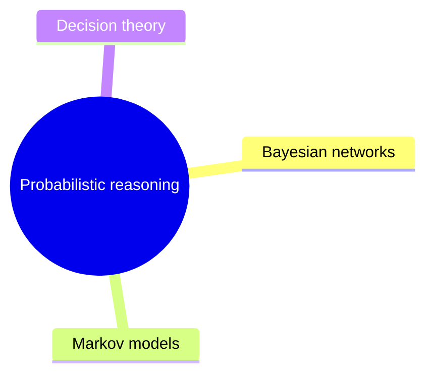

# Probabilistic reasoning

Representing and reasoning with uncertainty: Bayesian networks, Markov models and decision theory.

This knowledge area follows the knowledge unit AI-Probability (Probabilistic Representation and Reasoning) of the AI knowledge area in [Computer Science Curricula 2023](https://csed.acm.org/) (ACM, IEEE-CS and AAAI).

## Map

The map shows the sections of this knowledge area.

## Sections

- [Bayesian networks](bayesian-networks/README.md) (planned): Directed graphical models and inference in them.
- [Markov models](markov-models/README.md) (planned): Undirected and temporal probabilistic models.
- [Decision theory](decision-theory/README.md) (planned): Choosing actions under uncertainty by maximizing expected utility.

TODO: no notes yet in this knowledge area. Start with the first planned topic of the first section.
