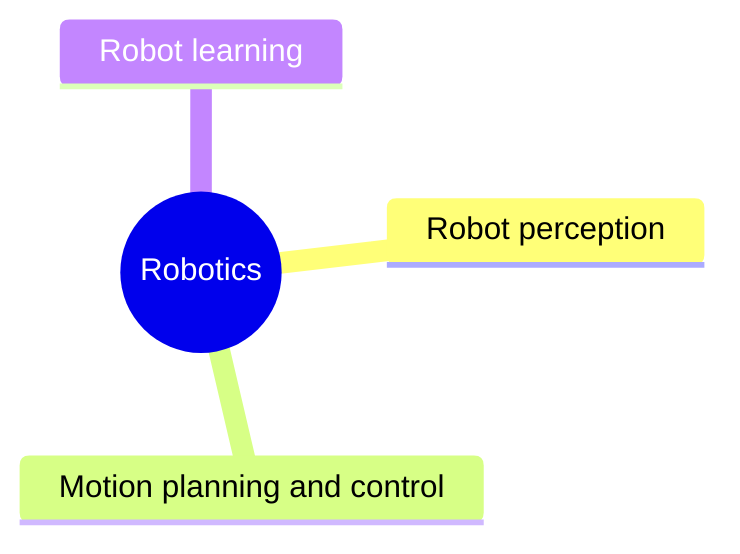

# Robotics

AI for physical agents: robot perception, localization and mapping, motion planning and control, and robot learning.

This knowledge area follows the knowledge unit AI-Robotics of the AI knowledge area in [Computer Science Curricula 2023](https://csed.acm.org/) (ACM, IEEE-CS and AAAI), with sections taken from the robotics chapter of Russell and Norvig's *Artificial Intelligence: A Modern Approach* (4th edition).

## Map

The map shows the sections of this knowledge area.

## Sections

- [Robot perception](robot-perception/README.md) (planned): Sensors and estimating the state of the robot and its world.
- [Motion planning and control](motion-planning-and-control/README.md) (planned): Planning collision-free motion and following it with feedback control.
- [Robot learning](robot-learning/README.md) (planned): Learning robot behavior from rewards, demonstrations and simulation.

TODO: no notes yet in this knowledge area. Start with the first planned topic of the first section.
