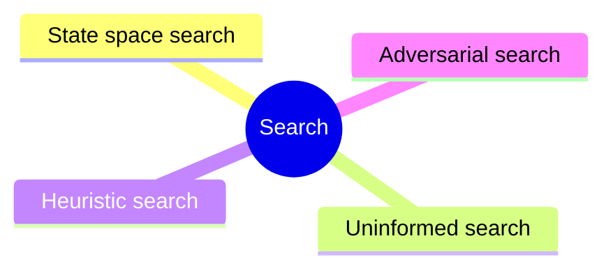

# Search

Problem solving by searching state spaces: uninformed and heuristic graph search, local search and adversarial search in games.

This knowledge area follows the knowledge unit AI-Search of the AI knowledge area in [Computer Science Curricula 2023](https://csed.acm.org/) (ACM, IEEE-CS and AAAI).

## Map

The map shows the sections of this knowledge area.

## Sections

- [State space search](state-space-search/README.md) (planned): Formulating a problem as states, goals and operators, and solving it by graph search.
- [Uninformed search](uninformed-search/README.md) (planned): Search strategies that use no knowledge about the goal beyond the problem definition.
- [Heuristic search](heuristic-search/README.md) (planned): Search guided by estimates of the distance to the goal, and local search over a landscape of solutions.
- [Adversarial search](adversarial-search/README.md) (planned): Search in two-player games, where an opponent chooses half of the moves.

TODO: no notes yet in this knowledge area. Start with the first planned topic of the first section.
